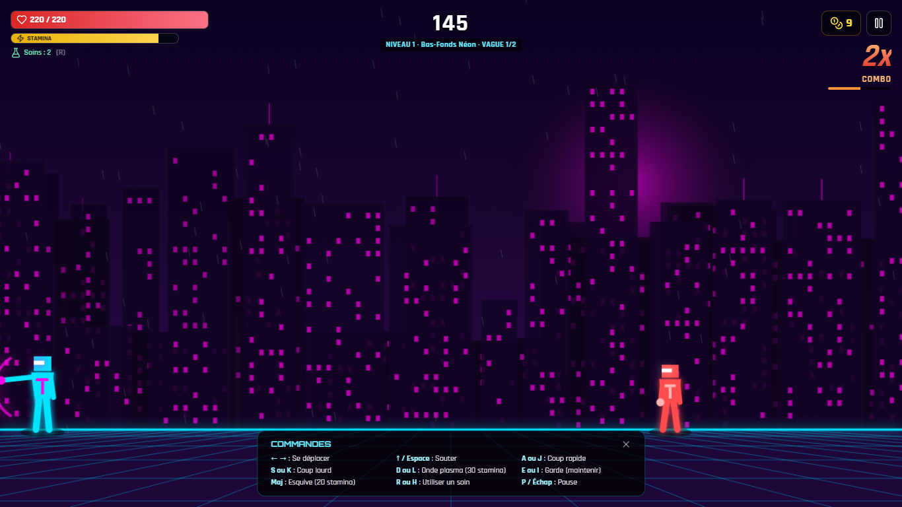
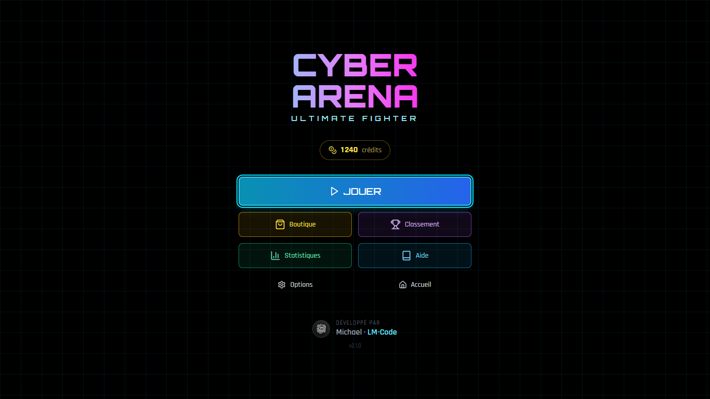
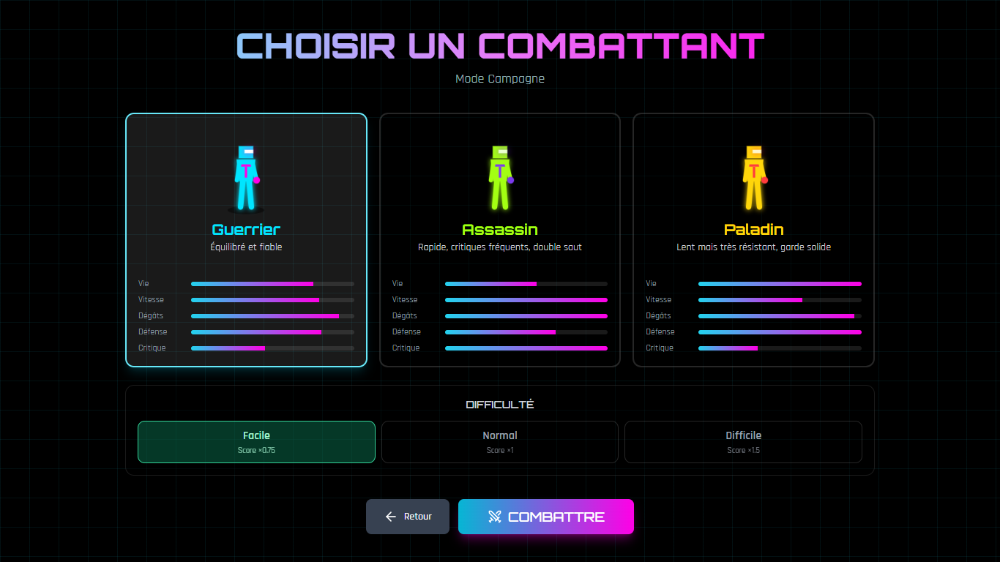
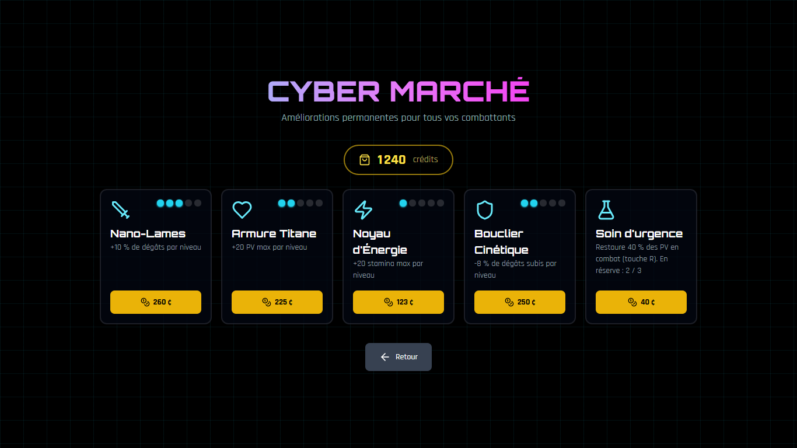
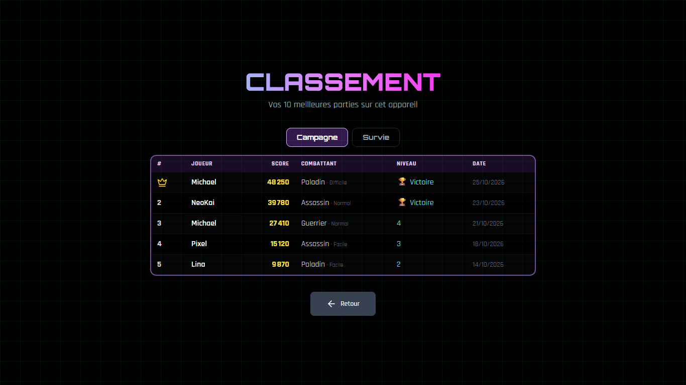
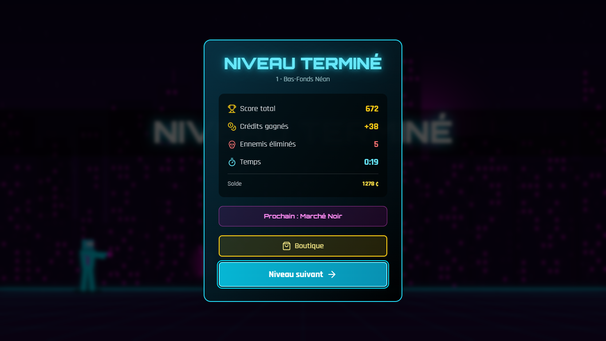
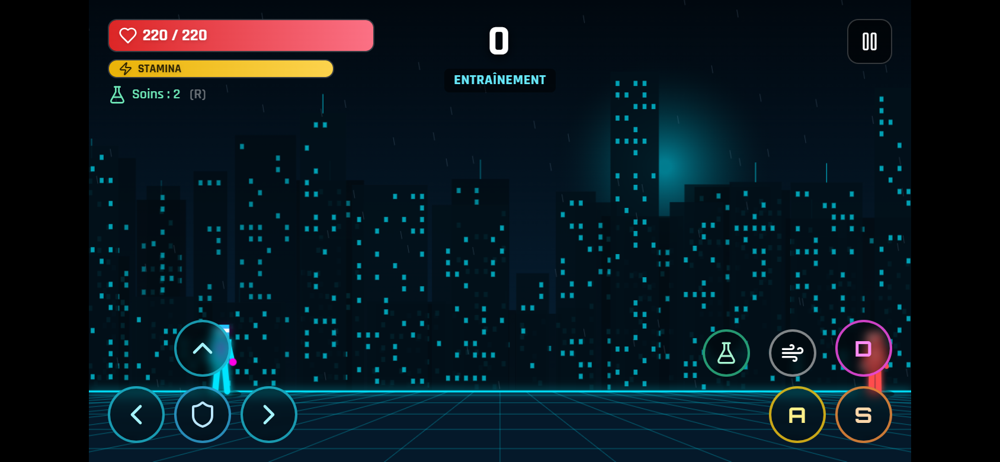

<div align="center">


# Cyber Arena Fighter

**Jeu de combat 2D cyberpunk, jouable directement dans le navigateur.**


Développé par **Michael — [LM-Code](https://lm-code.be)**

📖 **[Lire le tutoriel complet sur lm-code.be](https://lm-code.be/jeu-de-combat-react-canvas/)**

</div>



---

## Présentation

Cyber Arena Fighter est un jeu de combat en 2D dans un univers néon cyberpunk. Il fonctionne entièrement côté navigateur : aucun serveur ni aucune base de données ne sont nécessaires, et la progression est sauvegardée localement.

## Tutoriel

Envie de comprendre comment ce jeu fonctionne ou de le recréer vous-même ? Le tutoriel complet est disponible sur le site de LM-Code :

👉 **[Créer un jeu de combat 2D avec React et Canvas](https://lm-code.be/jeu-de-combat-react-canvas/)**

Il explique comment installer et tester le jeu, comment le code est organisé (moteur, rendu, audio, état), comment le transformer en PWA, le mettre en ligne et le reconstruire pas à pas à partir de zéro.

## Fonctionnalités

- **3 modes de jeu** : Campagne (5 niveaux et un boss final, TITAN-X), Survie (vagues infinies, avec un boss toutes les 5 vagues) et Entraînement (le joueur ne peut pas mourir).
- **3 combattants** aux styles différents : Guerrier, Assassin et Paladin.
- **3 niveaux de difficulté**, avec un multiplicateur de score.
- **Combat** : coups rapides et lourds, onde plasma, garde, esquive, double saut, combos et coups critiques.
- **5 types d'ennemis**, chacun avec sa propre intelligence artificielle, plus un boss en 3 phases.
- **Boutique** : 4 améliorations permanentes et des soins, achetés avec les crédits gagnés en combat.
- **Classement et statistiques** détaillées, sauvegardés dans le navigateur.
- **Musique et bruitages** synthétisés en temps réel avec la Web Audio API, sans aucun fichier audio.
- **Compatible mobile** : contrôles tactiles en mode paysage.
- **Performances** : boucle de jeu à pas fixe de 60 Hz et rendu sur Canvas 2D.

## Captures d'écran

| Menu principal | Sélection du combattant |
|---|---|
|  |  |
| **Boutique** | **Classement** |
|  |  |
| **Fin de niveau** | **Mobile** |
|  |  |

## Installation

**Prérequis :** [Node.js](https://nodejs.org) 20 ou une version plus récente.

```bash
git clone https://github.com/LM-Code-Be/cyber-arena.git
cd cyber-arena
npm install
npm run dev
```

Ouvrez ensuite **http://localhost:3000** dans votre navigateur.

## Scripts

| Commande | Description |
|---|---|
| `npm run dev` | Serveur de développement avec rechargement à chaud |
| `npm run build` | Build de production dans `dist/` |
| `npm run preview` | Prévisualisation locale du build |
| `npm run lint` | Analyse du code avec ESLint |

## Commandes

| Action | Clavier |
|---|---|
| Se déplacer | `←` `→` |
| Sauter | `↑` ou `Espace` |
| Coup rapide | `A` ou `J` |
| Coup lourd | `S` ou `K` |
| Onde plasma | `D` ou `L` |
| Garde (maintenir) | `E` ou `I` |
| Esquive | `Maj` |
| Soin | `R` ou `H` |
| Pause | `P` ou `Échap` |

Sur mobile, des boutons tactiles s'affichent automatiquement en mode paysage.

## Structure du projet

```
src/
├── game/            Moteur de jeu en JavaScript pur, indépendant de React
│   ├── constants.js   Données : personnages, ennemis, niveaux, équilibrage
│   ├── engine.js      Boucle de jeu, physique, IA, collisions, boss
│   ├── render.js      Rendu Canvas : décors et combattants
│   └── audio.js       Synthèse de la musique et des effets sonores
├── contexts/        État global et sauvegarde (localStorage)
├── components/      Interface React : écrans, HUD, contrôles tactiles
└── pages/           Accueil (/) et jeu (/game)
```

## Déploiement

Le build est un site entièrement statique, que l'on peut héberger n'importe où (Apache, Netlify, Vercel, Cloudflare Pages…).

```bash
npm run build
```

Envoyez ensuite le **contenu** du dossier `dist/` sur votre hébergement. Un fichier `.htaccess` est fourni pour Apache : il gère les routes de l'application et le cache. Sur les autres hébergeurs, configurez une redirection de toutes les routes vers `index.html`.

## Technologies

[React](https://react.dev) · [Vite](https://vitejs.dev) · [Tailwind CSS](https://tailwindcss.com) · [Framer Motion](https://www.framer.com/motion/) · [React Router](https://reactrouter.com) · [Radix UI](https://www.radix-ui.com) · [Lucide](https://lucide.dev) · Canvas 2D · Web Audio API

## Contribuer

Les contributions sont les bienvenues :

1. Forkez le dépôt.
2. Créez une branche : `git checkout -b feature/ma-fonctionnalite`.
3. Commitez vos changements, puis vérifiez le code avec `npm run lint`.
4. Ouvrez une Pull Request.

Pour signaler un bug ou proposer une idée, ouvrez une [issue](https://github.com/LM-Code-Be/cyber-arena/issues).

## Auteur

**Michael — LM-Code**

- Site web : [lm-code.be](https://lm-code.be)
- Tutoriel : [lm-code.be/jeu-de-combat-react-canvas](https://lm-code.be/jeu-de-combat-react-canvas/)
- GitHub : [@LM-Code-Be](https://github.com/LM-Code-Be)

## Licence

Ce projet est distribué sous **licence MIT**.

```
MIT License

Copyright (c) 2026 Michael — LM-Code (https://lm-code.be)

Permission is hereby granted, free of charge, to any person obtaining a copy
of this software and associated documentation files (the "Software"), to deal
in the Software without restriction, including without limitation the rights
to use, copy, modify, merge, publish, distribute, sublicense, and/or sell
copies of the Software, and to permit persons to whom the Software is
furnished to do so, subject to the following conditions:

The above copyright notice and this permission notice shall be included in all
copies or substantial portions of the Software.

THE SOFTWARE IS PROVIDED "AS IS", WITHOUT WARRANTY OF ANY KIND, EXPRESS OR
IMPLIED, INCLUDING BUT NOT LIMITED TO THE WARRANTIES OF MERCHANTABILITY,
FITNESS FOR A PARTICULAR PURPOSE AND NONINFRINGEMENT. IN NO EVENT SHALL THE
AUTHORS OR COPYRIGHT HOLDERS BE LIABLE FOR ANY CLAIM, DAMAGES OR OTHER
LIABILITY, WHETHER IN AN ACTION OF CONTRACT, TORT OR OTHERWISE, ARISING FROM,
OUT OF OR IN CONNECTION WITH THE SOFTWARE OR THE USE OR OTHER DEALINGS IN THE
SOFTWARE.
```

---

<div align="center">

Fait avec passion par <a href="https://lm-code.be"><b>LM-Code</b></a>

</div>
